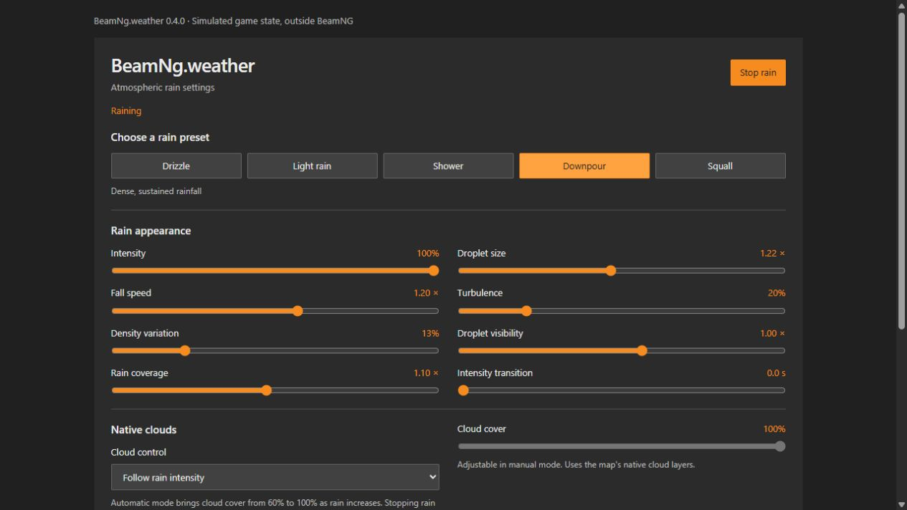

# BeamNg.weather

**Atmospheric rain for BeamNG.drive 0.40.x**, with three precipitation volumes,
original textures featuring 16 droplet variants per layer, five built-in presets
and three saved custom presets. Rain starts automatically after a map loads.

Version **0.6.3** smooths window-bead movement with size-dependent adhesion,
damped airflow response and bounded sliding speed. Glass uploads run at up to
20 Hz with the same particle caps. Stronger bead opacity and a new three-streak
near-rain atlas make rain more conspicuous without adding airborne geometry.
Classic beads remain the default; refraction remains an explicit experiment.
Near a protected vehicle,
the mod disables its native precipitation emitters and uses a bounded airborne
mesh that excludes the cabin, including the footwell and a margin for motion.
The classic gray/orange interface stays in English. Open the settings at:
**Esc > Mods > BeamNg.weather**. All controls are in English, and existing
settings and saved presets remain compatible.

**Experimental release for in-game testing.** Integration points were inspected
in a local **0.40.1.0** installation. Texture atlases were checked outside the
engine. Automated tests cover logic and packaging, not in-game rendering.

## Download and install

1. Download **[beamng_weather_hashk014.zip](https://github.com/hashk014/BeamNg.weather/releases/download/v0.6.3-alpha.1/beamng_weather_hashk014.zip)** from [Releases](https://github.com/hashk014/BeamNg.weather/releases).
2. In the BeamNG launcher, select **Manage User Folder**, then open the active user folder.
3. Put the ZIP in its `mods` subfolder **without extracting it**. Create the
   subfolder if needed. When updating, replace the old ZIP with the same name.
4. Restart the game, enable the mod in Mod Manager and load a **Freeroam** map.
   Rain should begin after a few seconds.

Do not install files in the game's Steam directory. The mod ZIP contains
`art/`, `lua/`, `scripts/`, `shaders/` and `ui/` directly. GitHub's automatic **Source code**
archives are for developers and are not installable mod packages.
Keep only one installed copy, named `beamng_weather_hashk014.zip`, when updating.
Remove older downloads with suffixes such as `(1)` from the `mods` folder.

## Open the rain controls

1. Load a Freeroam map and press **Esc** to open the pause menu.
2. Select the **Mods** category.
3. Select **BeamNg.weather** in the mod list. When it is the only registered
   mod entry, the game selects its page automatically when you open Mods.
4. Adjust the rain controls or load a preset. Changes are saved automatically;
   sliders apply when released. Close the menu to view the result in motion.

The page includes every control and all three custom preset slots. Cloud mode
and particle budget use expandable option lists inside the panel: click to open,
then select an option. Tab/Enter/Space work with the buttons; Escape closes an
open list. These controls do not use native browser popup menus. It uses
BeamNG 0.40's native mod-button registration and Vue component loader, without
replacing game UI files or binding its own Escape shortcut.



The original HUD panel remains optional: open **UI Apps > Add app** and search
for **BeamNg.weather**. Both interfaces share the same controller and saved
settings. If upgrading from 0.1, resize the old HUD panel or add it again.

### Built-in and custom presets

| Preset | Intended appearance |
| --- | --- |
| Drizzle | Fine droplets, slower fall and low density |
| Light rain | Subtle droplets and steady rainfall |
| Shower | More defined droplets and changing density |
| Downpour | Dense rainfall, larger droplets and faster fall |
| Squall | Stronger density variation and turbulence |

Selecting a preset applies its appearance and enables rain. Particle budget,
collisions, cloud control mode and transition duration remain global preferences. Adjusting the
appearance manually switches to custom settings.

The three **Custom** slots can save, overwrite, load and delete profiles.
They persist between sessions. Each slot stores rain appearance, cloud mode/coverage and wind/lighting
options, including the new glass/cabin controls, while particle budget, collisions
and transition duration remain global.

### Native clouds

**Follow rain intensity** is the default. Existing native `CloudLayer` objects use
the native **2.4–3** coverage range as rain intensity rises. The previous
0.4.0 release incorrectly treated 1 as the maximum; BeamNG's own environment
panel uses a maximum of 3. Choosing another rain preset updates
cloud cover immediately in automatic mode. **Manual cloud cover** lets you set
coverage from 0% to 100%, mapped to native 0–3; **Keep map settings** releases control of the sky.
Percentages describe the native setting range, not measured sky occlusion.
Stopping rain, setting intensity to zero, ending the map or unloading the mod
restores the previous cloud coverage. Native cloud edits observed while the mod
is active become the new restoration value. Wind and cloud textures stay unchanged.

Cloud mode is preserved when selecting built-in rain presets; custom slots store
both mode and coverage. Maps without native cloud layers, or game modes that
lock environment changes, show a warning while rain remains available.

### Native F11 rain coverage

On maps with a native **rain_coverage** object, the mod uses its volume dimensions
and distance-fade profile for the ambient rain layer. West Coast's **WCA_rain**
provides the same fallback profile source. Other maps use the mod's defaults.
The GUI shows the profile source. The source map object stays unchanged; the mod
renders a temporary layer with its own textures/shader so stop/unload is clean.
These F11 objects are native `Precipitation` volumes, not a glass/cabin mask.
The **Rain coverage** slider scales this volume along with the other rain layers.

### Cabin protection and vehicle windows

The **Vehicle windows** section in both interfaces controls these new effects.
Start with a closed-roof car and allow a few seconds for scanning and accumulation.
**Escape pauses the simulation**, including falling and sliding droplets.

- **Keep airborne rain outside the cabin:** derive a conservative cabin envelope
  from detected glass. A wider rounded envelope encloses every orientation of
  the cabin and its footwell, extended along the expected movement path. A stale
  air mesh is hidden if the vehicle moves outside that protected path.
  All three of this mod's native emitters are disabled while
  a replacement mesh renders airborne rain outside that envelope. The protection
  no longer depends on the precipitation shader receiving a fade-mask constant.
  No physical collider or vehicle-physics modification is added.
  This works near the player's current vehicle, with a camera guard radius of up
  to 12 m. A warning appears when the camera is too far for protection.
- **Enable droplets on detected exterior windows:** find windshield, rear, side
  window and sunroof meshes by their names/material metadata. Beads sit on their
  triangles and follow the vehicle pose. There is no screen-wide rain overlay.
- **Window droplet amount:** scales arrival from 0 to 4 times the denser base amount.
  **Window droplet size:** 0.5 to 2 times the base size; new settings default to 1.25.
- **Experimental refraction:** off by default, including when upgrading from
  0.6.0/0.6.1. Classic normal-mapped beads remain the default visible material.
  Only enable this checkbox to test the revised shader; its native sampler
  binding has been revised but its rendered output still needs validation.
- **Refraction strength (0 disables):** with the experimental checkbox enabled,
  distort the sampled scene image inside
  each bead, with a curved lens profile and a subtle rim/highlight. Range 0 to 2;
  default 1. Set it to 0 to use the previous normal-mapped material if the new
  shader is incompatible with your renderer. Existing saved sizes are preserved.
  Lua errors while setting up refraction automatically select the normal-mapped
  fallback and show a diagnostic. Changing strength retries setup; this does not
  detect every GPU shader/rendering failure.
- Vehicle velocity changes arrival rates and sliding direction, so reversing
  favors a different side than driving forward. Small beads cling more strongly;
  larger beads respond more to gravity and airflow. A 0.18-second response time
  smooths direction changes, with sliding capped at 0.08 m/s for the largest beads.
  The highlight stays oriented on the glass rather than flipping when flow reverses.
  This is an artistic water-motion model, not a fluid solver.
- Static roof tests stop new glass droplets under shelter. Existing beads run
  off and fade. A cached height grid clips nearby airborne rain below roofs.

The scan uses the game's GPU mesh API and does not redistribute vehicle assets.
The effects target **detected panes of the player's vehicle**, not every traffic
vehicle. Unconventional names, combined body/glass meshes and moving window parts
may be unsupported. Disable cabin protection for convertibles or open vehicles.
The envelope is conservative and does not model open doors or broken glazing.
Geometry is scanned again after a vehicle reset/switch; severe damage can leave
stale glass positions until reset. Refraction samples the rendered scene, so it
cannot reconstruct hidden objects or multiple optical layers. Wipers are absent.

Surface droplets are capped at 600 / 1,000 / 1,600 / 2,200 for Low / Balanced /
High / Ultra. The airborne mesh caps are 600 / 900 / 1,400 / 2,000.
It covers a radius of approximately 18 m times Volume around the camera, with
most drops concentrated within 6 m. Distant native rain returns when protection
is disabled or the camera leaves its supported range. Map-owned precipitation
and other mods remain untouched and may still enter the cabin.
Glass and airborne geometry refresh at up to 20 Hz;
the glass transform follows the vehicle every graphics frame. The wider exclusion
can remove some rain outside the car. FPS and native
mesh bindings still need in-game validation. See [validation](docs/VALIDATION.md).

Nearby air particles now display three varied rain streaks per quad, with a wider
silhouette and stronger opacity. The counters/budgets count particle quads, not
each painted streak. Classic window beads also have stronger rims and opacity.
Start with **Downpour**, **Window droplet amount 2**, and **Window droplet size 1.5**
for deliberately obstructive wet glass, then adjust to taste. In-game exposure,
lighting and graphics settings still affect visibility from inside the vehicle.

### Available settings

- **Enable / Stop** adds or removes only this mod's effects.
- **Intensity:** 0 to 100%. Zero removes the effects immediately.
- **Droplet size:** 0.5 to 2 times the base profile size.
- **Fall speed:** 0.4 to 1.8 times the base speed, with a different speed range
  for each layer. This multiplier is not a measurement in metres per second.
- **Particle budget:** Low 2,400; Balanced 6,000; High 12,000; Ultra 20,000.
  The counter shows the airborne count requested across native and near-rain effects.
  Window surface droplets have a separate bounded budget.
- **Turbulence**, **density variation**, **droplet visibility** and **rain
  coverage** are available under Advanced settings.
- **Intensity transition:** 0 to 5 seconds for a gradual approach to the new
  density. Stopping rain remains immediate.
- **Follow the map's existing wind:** affects droplets using the wind already
  present. The mod does not change global wind or forces acting on vehicles.
- **Match droplets to sky lighting:** uses native precipitation lighting.
  It does not simulate droplet optics under every headlight.
- **Collide with scenery and vehicles:** requests native precipitation collisions.
  Disabling collisions may improve performance but lets rain pass through shelter.

Settings are saved in `settings/beamngWeather_hashk014.json` in the active user
folder and persist between sessions. If rain was stopped, enable it again in
the panel for your next test.

Fallback commands in the console's **GE Lua** context:

```lua
extensions.beamngWeather_hashk014.setEnabled(true)
extensions.beamngWeather_hashk014.setIntensity(1)
extensions.beamngWeather_hashk014.setEnabled(false)
dump(extensions.beamngWeather_hashk014.getState())
```

If the extension is missing, first check that the mod is enabled.
**Ctrl+L** reloads game Lua and may be needed after enabling a mod mid-session.

## Scope and limitations

- Three native `Precipitation` objects provide fine nearby droplets, the main
  shower and a wider background volume using original textures.
- Each atlas contains 16 length, width and opacity variants, with tapered
  ends and a complete DDS mipmap chain.
- Each layer has its own size, fall-speed range and wind sensitivity.
  Slow, continuous variations keep density from remaining completely static.
- Native camera following and velocity-based orientation support driving
  cameras and free camera mode.
- Original standalone HLSL shaders provide precipitation lighting and distance fading.
  Original DDS atlases use DXT5/BC3 compression with complete mip chains.
- Existing maps, weather objects and materials are not replaced.
- Effect objects are temporary (`canSave = false`) and are removed when rain
  stops, the map changes or the extension unloads.
- No puddles, friction/grip changes, wet road materials, ground splashes or rain audio
  are included. Vehicle window droplets are optional.
- Shelter depends on map collision geometry. Cabin protection uses a conservative
  render envelope; it does not simulate every opening, deformation or broken pane.
- Other weather mods can add their own effects alongside this mod. Enable
  only this mod for an initial reproducible test.

## In-game test checklist

1. Load Gridmap v2, then West Coast USA, with only this mod enabled.
2. Inspect rain in exterior camera and free camera mode.
3. Press Esc, open Mods and select BeamNg.weather. Confirm the settings page
   appears without adding a HUD app. Close and reopen it, then reload Lua.
4. Try all five presets, enable/stop, zero intensity and all four particle budgets.
5. Adjust the rain and window sliders, then save and load a Custom preset. Restart the
   game and confirm the saved preset remains available.
6. Try automatic and manual clouds, then stop rain and confirm the previous sky returns. Check shelter with collisions on and off, then check the interior camera.
7. On a closed-roof car, wait for detected window meshes, then inspect each pane
   inside and outside. Drive forward, reverse, turn and stop. Enter and leave a
   tunnel; confirm no airborne rain in the cabin and no new window droplets under
   shelter. Check that existing beads drain. Test toggles and all particle budgets.
8. Change maps, switch/reset the vehicle, then reload Lua with Ctrl+L.
9. Disable the mod and confirm its menu entry and effects are removed while
   any other mods' entries remain available. Restart the game and check again.
10. Record FPS and errors containing `beamngWeather_hashk014` in `beamng.log`
   at the root of the active user folder.

When reporting a problem, include your exact game version, map, enabled mods,
a screenshot or video and the relevant log excerpt. The panel's **Raining**
status means effect objects were created; it does not verify their rendered output.

## Source and build

```text
mod/lua/ge/extensions/           GE Lua controller and visual profiles
mod/scripts/                    Automatic loading
mod/ui/modules/apps/            In-game AngularJS panel
mod/ui/ui-vue/mods/              Native pause menu settings component
mod/art/                        Original rain/glass textures, materials and datablocks
mod/shaders/                    Original standalone HLSL shaders
tests/                          LuaJIT and UI bridge tests with a mocked engine
tools/build.py                  Reproducible mod ZIP builder
tools/textures.py               Procedural texture generator
```

Development tools use Python 3.12 and Node.js. Neither is required to play.

```sh
python -m pip install -r requirements-dev.txt
python tools/textures.py --check
python -m unittest discover -s tests -v
node --check mod/ui/modules/apps/BeamngWeatherHashk014/app.js
node tests/test_ui.js
node tests/test_pause_ui.js
python tools/build.py
```

The installable ZIP and SHA-256 checksum are written to `dist/`. GitHub Actions
runs the same checks and uploads the ZIP as a build artifact.
See [docs/VALIDATION.md](docs/VALIDATION.md) for the scope of verification.
A local Python integration test reads the installed game's pause actions module.
That test is skipped in CI, where the game is unavailable; all portable tests
and both UI controller checks still run. The Node pause test also uses the
installed generic Lua bridge when available, without registering mod signatures.

## References and license

Original project under the [MIT license](LICENSE), including the textures
generated by `tools/textures.py`. No game textures are redistributed.
This project is not affiliated with BeamNG GmbH.

References: [datablock documentation](https://documentation.beamng.com/modding/levels/level_formats/datablocks/)
and [editor objects](https://documentation.beamng.com/world_editor/tools/create_object/).
Structures and APIs were inspected read-only in a local 0.40.1.0 installation,
including `core/modmanager.lua`, `core/camera.lua`, `core/environment.lua`,
`editor/createObjectTool.lua`, the `Winds` app and Jungle Rock Island's precipitation.
Movement and orientation concepts were also studied in
[Torque3D's precipitation code](https://github.com/TorqueGameEngines/Torque3D/blob/development/Engine/source/T3D/fx/precipitation.cpp).
