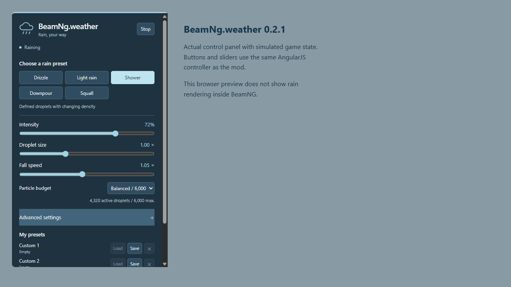

# BeamNg.weather

**Atmospheric rain for BeamNG.drive 0.40.x**, with three precipitation volumes,
original textures featuring 16 droplet variants per layer, five built-in presets
and three saved custom presets. Rain starts automatically after a map loads.

Version **0.2.1** makes the interface, presets, documentation and release notes
English. Existing settings and saved presets remain compatible.

**Experimental release for in-game testing.** Integration points were inspected
in a local **0.40.1.0** installation. Texture atlases were checked outside the
engine. Automated tests cover logic and packaging, not in-game rendering.

## Download and install

1. Download **[beamng_weather_hashk014.zip](https://github.com/hashk014/BeamNg.weather/releases/download/v0.2.1-alpha.1/beamng_weather_hashk014.zip)** from [Releases](https://github.com/hashk014/BeamNg.weather/releases).
2. In the BeamNG launcher, select **Manage User Folder**, then open the active user folder.
3. Put the ZIP in its `mods` subfolder **without extracting it**. Create the
   subfolder if needed. When updating, replace the old ZIP with the same name.
4. Restart the game, enable the mod in Mod Manager and load a **Freeroam** map.
   Rain should begin after a few seconds.

Do not install files in the game's Steam directory. The mod ZIP contains
`art/`, `lua/`, `scripts/` and `ui/` directly. GitHub's automatic **Source code**
archives are for developers and are not installable mod packages.
Keep the filename `beamng_weather_hashk014.zip` when updating.

## Open the rain controls

Open the **UI Apps** layout editor, choose **Add app** and search for
**BeamNg.weather**. The panel is optional; rain runs without it.
If upgrading from 0.1, resize the old panel or remove it and add it again.
Scroll inside the panel to reach advanced settings and custom preset slots.



### Built-in and custom presets

| Preset | Intended appearance |
| --- | --- |
| Drizzle | Fine droplets, slower fall and low density |
| Light rain | Subtle droplets and steady rainfall |
| Shower | More defined droplets and changing density |
| Downpour | Dense rainfall, larger droplets and faster fall |
| Squall | Stronger density variation and turbulence |

Selecting a preset applies its appearance and enables rain. Particle budget,
collisions and transition duration remain global preferences. Adjusting the
appearance manually switches to custom settings.

The three **Custom** slots can save, overwrite, load and delete profiles.
They persist between sessions. Each slot stores rain appearance and wind/lighting
options, while particle budget, collisions and transition duration remain global.

### Available settings

- **Enable / Stop** adds or removes only this mod's effects.
- **Intensity:** 0 to 100%. Zero removes the effects immediately.
- **Droplet size:** 0.5 to 2 times the base profile size.
- **Fall speed:** 0.4 to 1.8 times the base speed, with a different speed range
  for each layer. This multiplier is not a measurement in metres per second.
- **Particle budget:** Low 2,400; Balanced 6,000; High 12,000; Ultra 20,000.
  The counter shows the combined particle count requested from the three objects.
- **Turbulence**, **density variation**, **droplet visibility** and **rain
  coverage** are available under Advanced settings.
- **Intensity transition:** 0 to 5 seconds for a gradual approach to the new
  density. Stopping rain remains immediate.
- **Follow the map's existing wind:** affects droplets using the wind already
  present. The mod does not change global wind or forces acting on vehicles.
- **Match droplets to sky lighting:** uses native precipitation lighting.
  It does not simulate droplet optics under every headlight.
- **Collide with scenery and vehicles:** requests native precipitation collisions.
  Disabling collisions may improve performance but lets rain pass through shelter.

Settings are saved in `settings/beamngWeather_hashk014.json` in the active user
folder and persist between sessions. If rain was stopped, enable it again in
the panel for your next test.

Fallback commands in the console's **GE Lua** context:

```lua
extensions.beamngWeather_hashk014.setEnabled(true)
extensions.beamngWeather_hashk014.setIntensity(1)
extensions.beamngWeather_hashk014.setEnabled(false)
dump(extensions.beamngWeather_hashk014.getState())
```

If the extension is missing, first check that the mod is enabled.
**Ctrl+L** reloads game Lua and may be needed after enabling a mod mid-session.

## Scope and limitations

- Three native `Precipitation` objects provide fine nearby droplets, the main
  shower and a wider background volume using original textures.
- Each atlas contains 16 length, width and opacity variants, with tapered
  ends and a complete DDS mipmap chain.
- Each layer has its own size, fall-speed range and wind sensitivity.
  Slow, continuous variations keep density from remaining completely static.
- Native camera following and velocity-based orientation support driving
  cameras and free camera mode.
- The mod binds the game's existing precipitation shaders for lighting and
  distance fading. Those game shaders are not redistributed.
- Existing maps, weather objects and materials are not replaced.
- Effect objects are temporary (`canSave = false`) and are removed when rain
  stops, the map changes or the extension unloads.
- No windshield effects, puddles, friction or grip changes, wet materials,
  surface splashes or rain audio are included.
- Shelter and cabin behaviour depend on native collision handling and map
  geometry. Collisions do not guarantee realistic windshield protection.
- Other weather mods can add their own effects alongside this mod. Enable
  only this mod for an initial reproducible test.

## In-game test checklist

1. Load Gridmap v2, then West Coast USA, with only this mod enabled.
2. Inspect rain in exterior camera and free camera mode.
3. Try all five presets, enable/stop, zero intensity and all four particle budgets.
4. Adjust all eight sliders, then save and load a Custom preset. Restart the
   game and confirm the saved preset remains available.
5. Check shelter with collisions on and off, then check the interior camera.
6. Change maps, reset the vehicle and reload Lua with Ctrl+L.
7. Disable the mod and restart the game to confirm its effects are removed.
8. Record FPS and errors containing `beamngWeather_hashk014` in `beamng.log`
   at the root of the active user folder.

When reporting a problem, include your exact game version, map, enabled mods,
a screenshot or video and the relevant log excerpt. The panel's **Raining**
status means effect objects were created; it does not verify their rendered output.

## Source and build

```text
mod/lua/ge/extensions/           GE Lua controller and visual profiles
mod/scripts/                    Automatic loading
mod/ui/modules/apps/            In-game AngularJS panel
mod/art/                        Original DDS textures and datablocks
tests/                          LuaJIT and UI bridge tests with a mocked engine
tools/build.py                  Reproducible mod ZIP builder
tools/textures.py               Procedural texture generator
```

Development tools use Python 3.12 and Node.js. Neither is required to play.

```sh
python -m pip install -r requirements-dev.txt
python tools/textures.py --check
python -m unittest discover -s tests -v
node --check mod/ui/modules/apps/BeamngWeatherHashk014/app.js
node tests/test_ui.js
python tools/build.py
```

The installable ZIP and SHA-256 checksum are written to `dist/`. GitHub Actions
runs the same checks and uploads the ZIP as a build artifact.
See [docs/VALIDATION.md](docs/VALIDATION.md) for the scope of verification.

## References and license

Original project under the [MIT license](LICENSE), including the textures
generated by `tools/textures.py`. No game textures are redistributed.
This project is not affiliated with BeamNG GmbH.

References: [datablock documentation](https://documentation.beamng.com/modding/levels/level_formats/datablocks/)
and [editor objects](https://documentation.beamng.com/world_editor/tools/create_object/).
Structures and APIs were inspected read-only in a local 0.40.1.0 installation,
including `core/modmanager.lua`, `core/camera.lua`, `core/environment.lua`,
`editor/createObjectTool.lua`, the `Winds` app and Jungle Rock Island's precipitation.
Movement and orientation concepts were also studied in
[Torque3D's precipitation code](https://github.com/TorqueGameEngines/Torque3D/blob/development/Engine/source/T3D/fx/precipitation.cpp).
