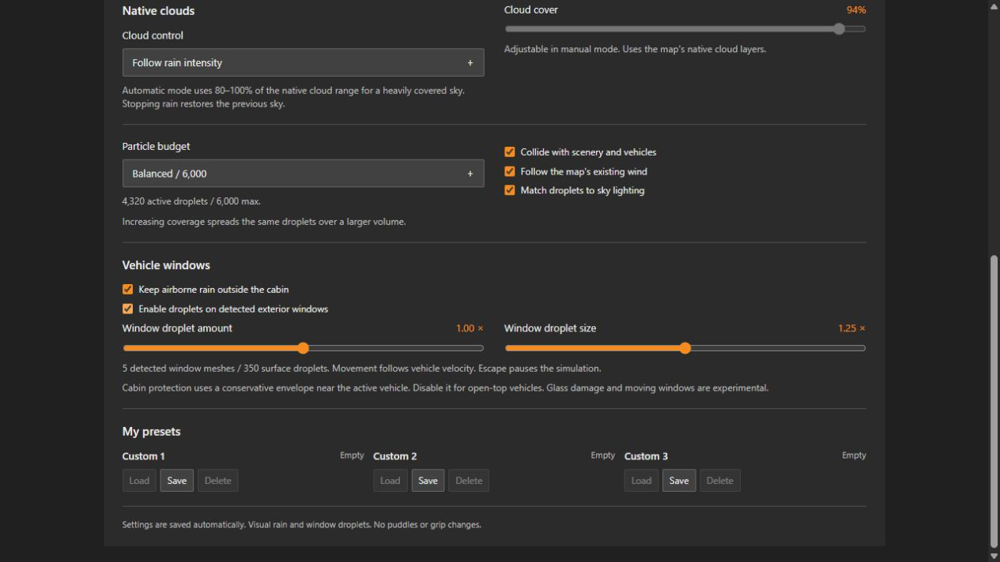

# Validation: 0.5.1 experimental release

Date: October 22, 2026. Target: BeamNG.drive 0.40.x; installed reference: 0.40.1.0.

## Reported failure and correction

A user screenshot from 0.5.0 shows `Glass scan failed: ... Too many glass triangles`, with zero detected panes and droplets. This proves the scan abort, but does not identify which mesh/range caused the overflow. The old scanner reproduces the same error in two new synthetic cases: repeated primitive ranges and legitimate high-detail glass. Both pass after the correction.

0.5.1 filters primitives with `vehicle:getMaterialNames()[materialId + 1]`, using the mapping in the installed game's `util/export.lua`, and removes repeated ranges/indexed triangles. It samples glass above 30,000 candidates across all panes rather than aborting. Additional regressions check material filtering, duplicate triangles and missing material-table fallback. Sampling can shorten sliding and is reported in the GUI. Scan counts/failures are logged. No installed vehicle assets are distributed.

## Evidence and completed checks

- **41 local Python/LuaJIT 2.1 (Lua 5.1) tests.** CI runs 40 portable tests and
  skips the installed-game pause-actions integration. Both Node UI checks pass.
- Existing lifecycle, presets, cloud restoration, persistence/migration, budget,
  failure recovery, pause registration, texture and deterministic archive checks.
- Fourteen synthetic tests exercise the actual vehicle-effect modules using the
  native GPU-mesh and ProceduralMesh API shapes: five exterior glass surfaces;
  interior/lamp exclusion; GPU-buffer freeing; forward/reverse impact and sliding;
  exclusion of near drops from the cabin; static shelter; pause; toggles; reset;
  asynchronous mesh timeout; corrupt-data fallback; camera distance; pose tracking;
  world-space near particles; PNG alpha fading and normal variation.
- Native F11 `rain_coverage` objects were inspected read-only in the installed Jungle Rock Island, Small Island and East Coast level archives; West Coast has `WCA_rain`. They are `Precipitation` volumes, not a separate vehicle-occlusion API. The mod inherits volume dimensions/fade for its owned ambient layer and falls back elsewhere. A regression test checks profile use, fallback and preservation of the source object.
- Main-controller integration verifies native shader guarding, the shared airborne
  budget, and cleanup through mission end and serialization with vehicle effects.
- GPU mesh calls were checked against the installed game's `util/export.lua`:
  `GPUMesh.bng_getGPUMesh`, `dataIsReady`, `verticesGet`, `indicesGet`,
  `flexmeshes`, `primitivesGet` and `free`. These are read-only snapshots.
- ProceduralMesh format/collision disabling checked in the installed game's
  `editor/toolUtilities/meshPart.lua`; pose and quaternion APIs checked in core
  scripts. Vertex/normal/UV face indices are verified by the synthetic boundary.
- Native guard constants reuse the renderer's fade fields. Both revised HLSL
  stages compile with Windows SDK FXC (SM5) and DXC (SM6). This is offline
  compilation, not proof of runtime shader bindings or rendering.
- Original four BC3 DDS and two glass PNG textures regenerate identically.
  Independent image decoding checks alpha, atlas variants, mipmaps and normals.
- Vue settings page rendered in a browser using the installed game's Vue build,
  with simulated state. New glass/cabin controls checked through the visible UI.
- ZIP entries use safe relative paths, match source exactly and are reproducible.

## Native behavior still awaiting gameplay validation

The game has not been controlled for this update. Tests do **not** establish
that the native GPU snapshot coordinates, PBR transparency/normal maps, quaternion
pose attachment, camera guard and dynamic mesh uploads render correctly in the
actual game. Confirm all of them on real stock cars before treating this as a
verified cabin/window feature. Actual FPS, DirectX/Vulkan differences and damage
behavior are unmeasured.

Cabin protection is a conservative glass-derived envelope, active near the player
vehicle with a 12 m camera guard. It can remove some air outside the actual cabin.
Turn it off for open-top vehicles. The implementation does not model each opening
or update flexbody deformation continuously. Damage/opening windows may require
reset, and unconventional mesh names or combined body meshes may not be supported.
Window water is normal-mapped bead geometry, not full optical refraction; wipers
are not implemented. New arrivals stop under static shelter, while existing beads
run off. Collision sampling and exposure are approximate and map-dependent.

If scanning/render-mesh creation fails, the effect reports a diagnostic and leaves
native airborne rain unmasked. This fallback cannot guarantee a dry cabin.
The UI's **Raining** status confirms requested objects/counts, not rendered output.
Close Escape to run the simulation. Use the detailed test checklist in the README.

No road wetness, puddles, grip/friction changes, ground splashes or rain audio are
implemented. No original vehicle assets or game scripts are overwritten.
